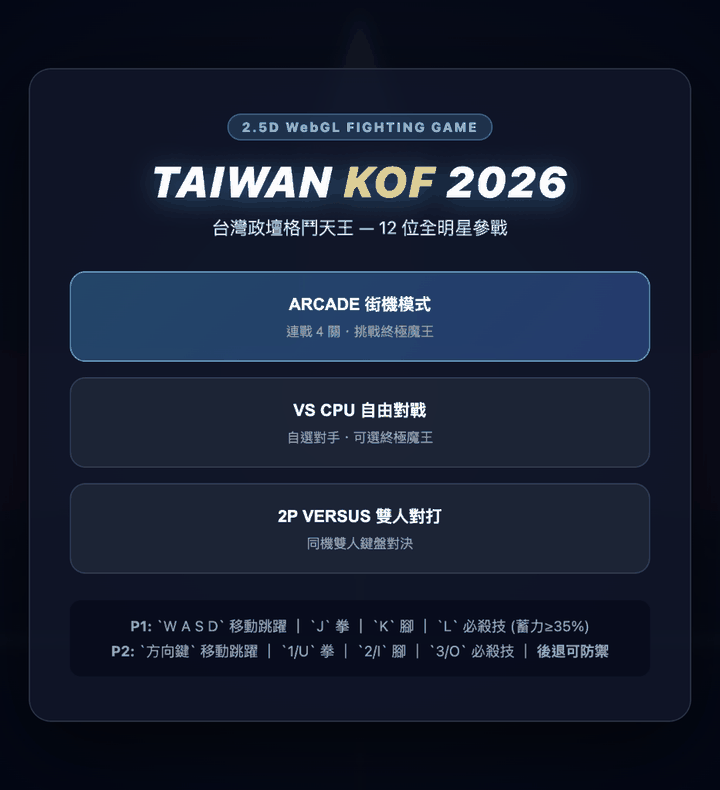
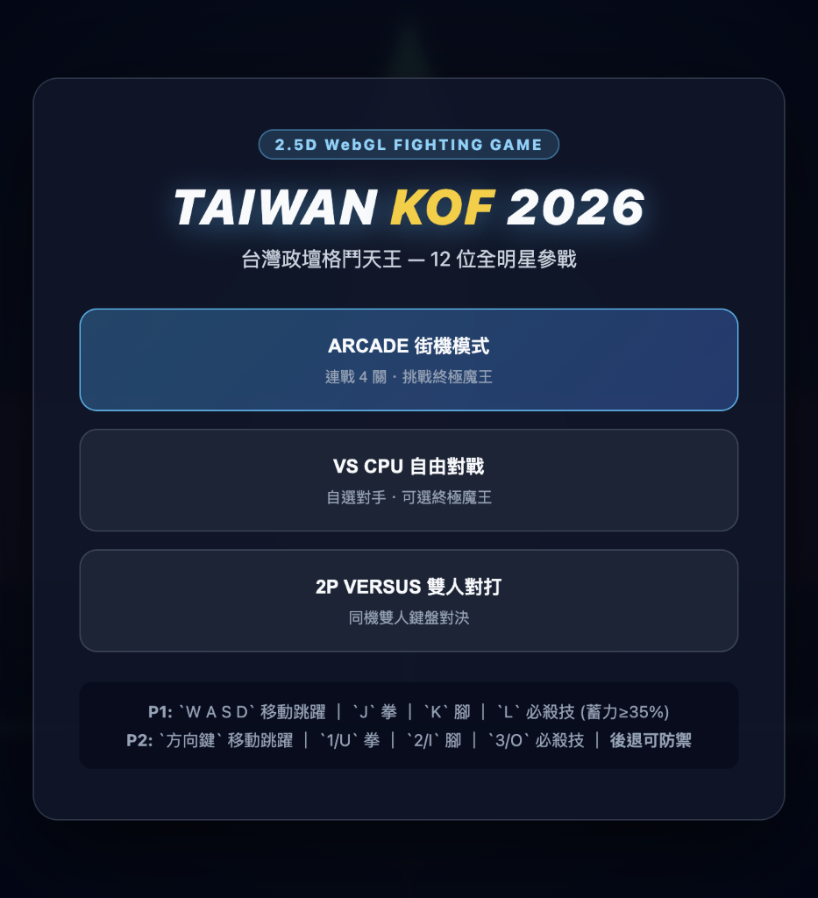
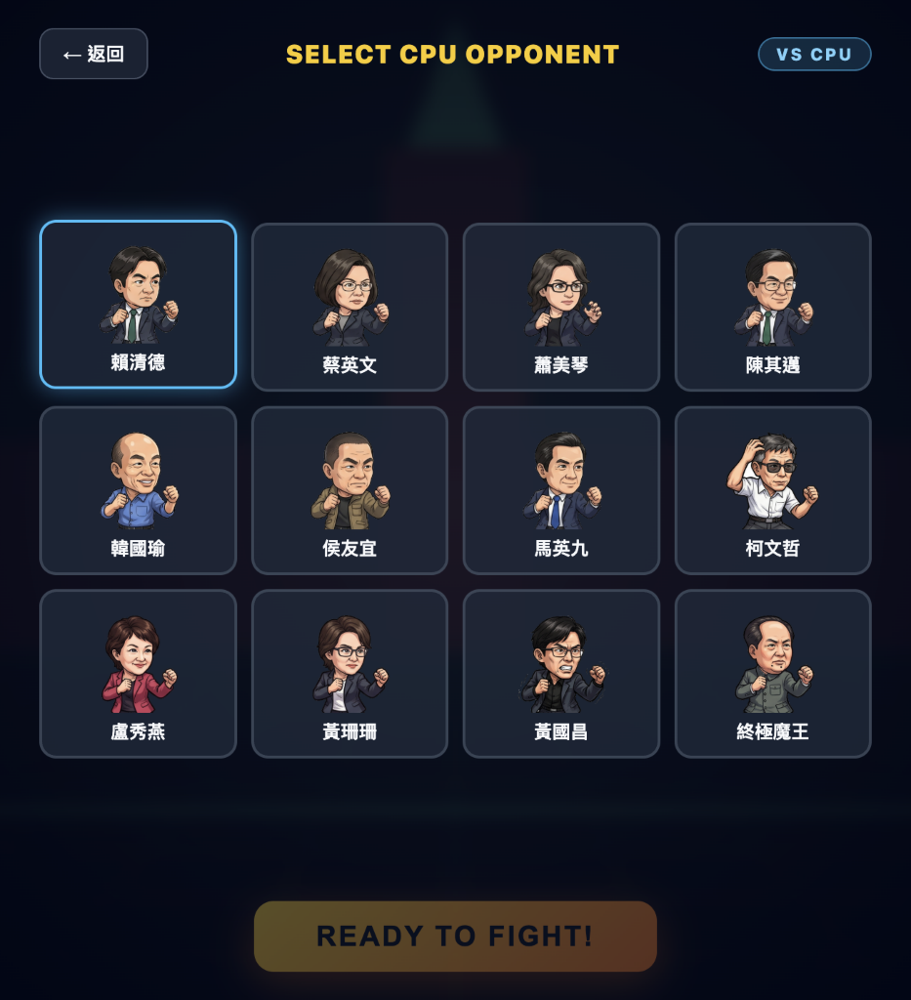
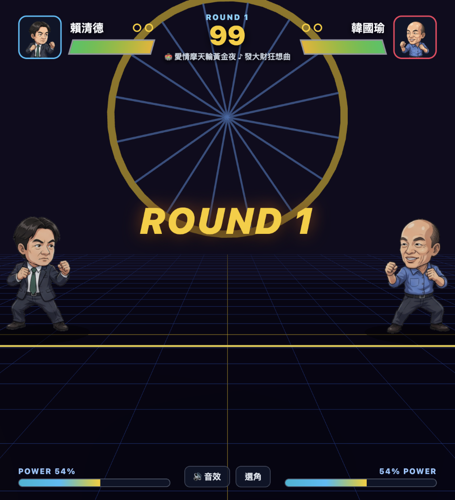
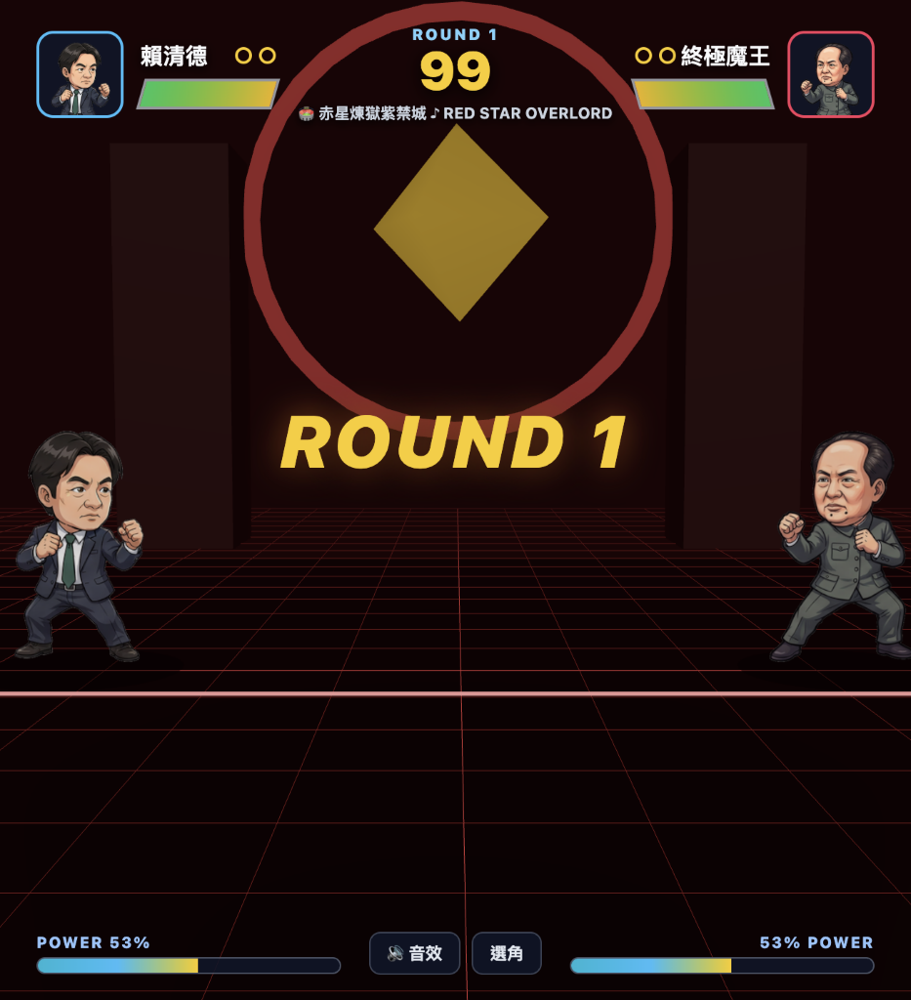

# TAIWAN KOF 2026 — 台灣格鬥天王 🥊

> 一款使用 **Three.js (2.5D WebGL)** 與 **Web Audio API** 打造的多角色精靈圖格鬥遊戲。  
> 12 位全明星角色、12 座專屬 3D 舞台場景、12 首獨立合成戰鬥配樂、2D 骨骼動態變形與電腦／手機雙平台操作，打開瀏覽器即可開戰！

🎮 **線上立即遊玩（GitHub Pages）**：https://klkuo.github.io/taiwan-kof-2026/  
📦 **GitHub 專案位址**：https://github.com/klkuo/taiwan-kof-2026

---

## 📸 實機畫面預覽



| 模式選單 | 12 位全明星選角 |
| :---: | :---: |
|  |  |

| 愛情摩天輪黃金夜 | 赤星煉獄紫禁城 |
| :---: | :---: |
|  |  |

---

## ✨ 遊戲特色

- **12 位趣味諧音全明星參戰**：保留原姓氏的格鬥諧音命名，每位角色皆有專屬必殺技（客製化 3D 飛行道具、SOP 全息面板、金元寶、冰晶、光束砲、衝擊波、震地柱、疾風連踢）。
- **2D 骨骼權重變形與殘影特效**：不需額外美術圖檔，透過程式驅動 `Hip → Spine → Head` 骨骼權重網格，實現呼吸起伏、出招蓄力前傾、落地壓扁緩衝、受擊後仰與高速殘影。
- **格鬥手感系統**：
  - **連段取消（Chain Combo）**：輕拳命中後可直接取消接踢擊或必殺技（`J → K → L`）。
  - **雙擊衝刺（Dash）**：連按兩下左或右方向鍵快速前衝／後撤。
  - **MAX 超必殺技暗幕特寫**：能量 100% 施放必殺技時觸發舞台壓暗＋鏡頭特寫＋高強度爆閃。
- **12 座專屬 3D WebGL 舞台**：開戰時自動切換成對手的 3D 特色舞台（總統府廣場、高雄 85 大樓、愛情摩天輪、台中歌劇院、台北大巨蛋、赤星煉獄紫禁城等），並支援**宿敵開場台詞**與**同角色對戰 2P 異色版**。
- **開場 3 秒倒數口白、KO 口頭禪與完整音效控制**：
  - 第 1 回合開場進行 `3 → 2 → 1 → FIGHT!` 倒數，雙方依序跳出開場口白並支援中文語音（Web Speech API）；擊倒對手瞬間勝方會喊出專屬 KO 口頭禪。
  - 內建 12 首角色專屬 Web Audio 合成 BGM、打擊／防禦／KO 音效，並提供**即時音量滑桿**（自動記憶於瀏覽器）、**靜音切換**與 **`ESC` 暫停選單**。
- **電腦與手機雙平台支援**：手機或平板開啟網址時自動顯示**多點觸控虛擬方向鍵與攻擊鈕**（支援一邊移動一邊出招），並附有直立橫屏建議提示。
- **三種對戰模式**：
  - **ARCADE 街機模式**：連戰 4 關，最終挑戰 **終極魔王**（三戰兩勝制）。
  - **VS CPU 自由對戰**：自由挑選自己與電腦對手（可直接選用終極魔王）。
  - **2P VERSUS 雙人對打**：同機雙人鍵盤即時對決。

---

## 🕹️ 操作說明

### 電腦鍵盤
| 玩家 | 移動 / 跳躍 | 雙擊衝刺 | 後退防禦 | 拳擊 | 踢擊 | 必殺技（能量 ≥ 35%，100% 為 MAX） |
| :--- | :--- | :--- | :--- | :--- | :--- | :--- |
| **P1** | `W` `A` `S` `D` | 連按兩下 `A` / `D` | 往對手反方向按住 | `J` | `K` | `L` 或 `U` |
| **P2** | `↑` `←` `↓` `→` | 連按兩下 `←` / `→` | 往對手反方向按住 | `1` 或 `I` | `2` 或 `O` | `3` 或 `P` |

- **暫停遊戲**：對戰中按 `ESC` 或點擊畫面下方 `⏸ 暫停` 按鈕。

### 手機 / 平板觸控
- 開啟遊戲後自動顯示左側虛擬方向鍵（`◀` / `▲` / `▶`）與右側動作鍵（`拳` / `腳` / `必殺`），建議橫放螢幕遊玩。

---

## 👥 角色、專屬舞台與主題曲一覽

| ID | 角色名稱 | 稱號 | 專屬必殺技 | 專屬 3D 舞台 | 專屬 BGM |
| :--- | :--- | :--- | :--- | :--- | :--- |
| `li` | **賴輕得** | 信賴拳宗師 | 台灣意志波 | 凱達格蘭總統府廣場 | 信賴進行曲 |
| `tsai` | **蔡贏穩** | 數位盾牌防衛者 | 辣台妹數位盾 | 數位資安矩陣空間 | Cyber Defense 2026 |
| `hsiao` | **蕭美擒** | 戰貓外交官 | 戰貓疾風波 | 華府雙橡園夜空 | 戰貓疾風 |
| `chen` | **陳誰扁** | 台灣之子波動拳 | 台灣之光砲 | 南台灣海港 85 大樓 | 有夢最美進行曲 |
| `han` | **韓國魚** | 金元寶拳王 | 發大財元寶砲 | 愛情摩天輪黃金夜 | 發大財狂想曲 |
| `ho` | **侯友誼** | 鐵漢震地使 | 好好做事震地柱 | 新北耶誕鋼鐵城 | 鐵漢重裝 |
| `ma` | **馬英酒** | 冰霜握拳者 | 極寒冰晶碎 | 極寒冰晶聖殿 | 霜雪無痕 |
| `ko` | **柯問哲** | SOP 光束博士 | 究極 SOP 雷射 | 台北北門 SOP 全息實驗室 | SOP 演算法 |
| `lu` | **盧秀焰** | 粉紅守護者 | 媽媽粉紅衝擊波 | 台中國家歌劇院粉紅夜 | 粉紅守護星 |
| `san` | **黃閃閃** | 雙影疾風踢 | 雙影旋風連踢 | 台北大巨蛋霓虹競技場 | 雙影電光 |
| `huan` | **黃國唱** | 咆哮戰神 | 太離譜了咆哮砲 | 立法院咆哮雷霆殿 | 太離譜了交響曲 |
| `mo` | **終極魔王** | 赤星霸主 | 赤星毀滅波動 | 赤星煉獄紫禁城 | RED STAR OVERLORD |

---

## 🗂️ 專案架構

```text
taiwan-kof-2026/
├── assets/                   # 原始角色精靈圖（單排或雙排白底原圖）
├── docs/                     # README 實機 GIF 動圖與截圖
├── public/sprites/           # 腳本產出的透明單排精靈圖、頭像與 sprites.json
├── scripts/
│   └── process_sprites.py    # Python 自動去背、2D 動作切割與基準線對齊腳本
├── src/
│   ├── roster.js             # 12 位角色數值、台詞、必殺技、舞台與宿敵設定
│   ├── stages.js             # 12 座 3D WebGL 專屬場景與動態地標
│   ├── rig.js                # 2D 骨骼權重變形控制器（呼吸/蓄力/落地壓扁/受擊）
│   ├── renderer.js           # Three.js 2.5D 攝影機、3D 飛行道具、殘影與粒子特效
│   ├── physics.js            # 60fps 格鬥物理、連段取消、衝刺、防禦與頓幀
│   ├── audio.js              # Web Audio BGM 音序器、音效合成、音量控制與中文語音
│   ├── ai.js                 # 反應式電腦對手 AI
│   ├── main.js               # 遊戲狀態機、3 秒倒數、觸控/鍵盤輸入與 HUD
│   └── style.css             # 街機介面與行動裝置響應式樣式
├── .github/workflows/
│   └── deploy.yml            # GitHub Actions 自動建置並部署至 GitHub Pages
├── index.html
├── vite.config.js            # 相對路徑與 Three.js 獨立分包設定
└── package.json
```

---

## 🛠️ 本機開發與自訂教學

### 1. 啟動遊戲開發伺服器
```bash
npm install
npm run dev
```
打開終端機顯示的 `http://localhost:5173` 即可遊玩與即時熱重載修改。

### 2. 新增或替換角色精靈圖
將白底動作圖放入 `assets/` 後執行：
```bash
python3 -m venv .venv
.venv/bin/pip install pillow numpy scipy
.venv/bin/python scripts/process_sprites.py
```
腳本會自動去背、偵測單排／雙排動作、對齊腳底並更新 `public/sprites/sprites.json`，接著在 `src/roster.js`、`src/stages.js`、`src/audio.js` 補上角色設定即可！

### 3. 建置正式版
```bash
npm run build
```

---

## 🤝 歡迎分享、Fork 與二次創作！

這個專案是作為 WebGL 格鬥遊戲的實驗與娛樂作品，**非常歡迎大家把網址分享給朋友同樂，也強烈鼓勵 Fork 回去自由魔改**！

你可以試著延伸這些有趣點子：
- 🆕 **加入新角色與新招式**：放進自己畫的精靈圖、自訂角色數值與專屬必殺技。
- 🏆 **加入通關紀錄與稱號徽章**：用 `localStorage` 記錄打贏終極魔王的次數與最高連擊。
- 🎵 **魔改舞台與音樂**：在 `src/stages.js` 蓋出更多台灣地標，或在 `src/audio.js` 編寫更熱血的 Chiptune / 搖滾旋律。
- 🌐 **加入連線對戰**：結合 WebRTC / WebSocket 實現線上 PVP。

覺得好玩的話，歡迎在 GitHub 按一顆 ⭐ **Star**，或直接開 **Pull Request** 一起把台灣格鬥宇宙做得更豐富！
